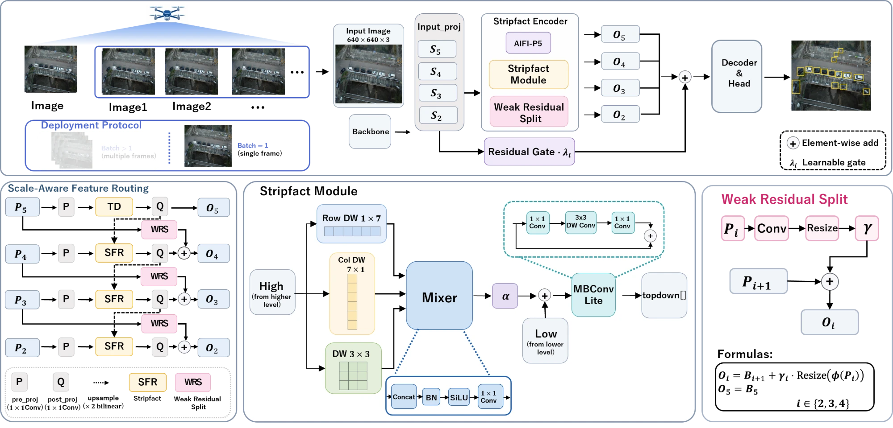

<h2 align="center">
  LiteUAV-DETR: Scale-Aware Feature Routing for Real-Time UAV Detection
</h2>

<p align="center">
    <a href="LICENSE">
        
    </a>
    <a href="https://bmvc2026.bmva.org/proceedings/papers/paper_01296/">
        
    </a>
</p>

<p align="center">
    📄 This is the official implementation of the paper:
    <br>
    <a href="https://bmvc2026.bmva.org/proceedings/papers/paper_01296/">LiteUAV-DETR: Scale-Aware Feature Routing for Real-Time UAV Detection</a>
</p>

<p align="center">
Mingze Sun, Zhuoyu Wu, Tan Pei Sze, Jit Yan Lim, Raphaël C-W Phan, and Shu-Min Leong
</p>

<p align="center">
BMVC 2026
</p>

<p align="center">
    
</p>

LiteUAV-DETR is a lightweight real-time detector for UAV imagery. Its scale-aware feature routing encoder cuts the cost of multi-scale interaction while keeping the cues that small objects need.

## Model Zoo

### VisDrone
| Model | Backbone | AP<sup>val</sup> | AP<sub>50</sub> | AP<sub>75</sub> | AR<sub>100</sub> | #Params | Latency | config | checkpoint |
| :---: | :---: | :---: | :---: | :---: | :---: | :---: | :---: | :---: | :---: |
| **LiteUAV&#8209;DETR&#8209;UltraFast** | HGNetV2-B0 | **28.19** | 46.27 | 28.93 | 45.17 | 3.80M | 21.6ms | [yml](./configs/liteuavdetr/custom/liteuavdetr_ultrafast_visdrone_640.yml) | [28.19](https://github.com/KyoukoChan-SSS/LiteUAV-DETR/releases/download/v1.0.0/stripfact_res_n_visdrone_best_stg2.pth) |
| **LiteUAV&#8209;DETR&#8209;Fast** | HGNetV2-B2 | **32.55** | 52.95 | 33.58 | 48.18 | 13.72M | 27.7ms | [yml](./configs/liteuavdetr/custom/liteuavdetr_fast_visdrone_640.yml) | [32.55](https://github.com/KyoukoChan-SSS/LiteUAV-DETR/releases/download/v1.0.0/stripfact_res_m_visdrone_best_stg2.pth) |

### UAVDT
| Model | Backbone | AP<sup>test</sup> | AP<sub>50</sub> | AP<sub>75</sub> | AP<sub>S</sub> | AP<sub>M</sub> | config | checkpoint |
| :---: | :---: | :---: | :---: | :---: | :---: | :---: | :---: | :---: |
| **LiteUAV&#8209;DETR&#8209;UltraFast** | HGNetV2-B0 | **19.4** | 33.3 | 20.2 | 13.3 | 29.3 | [yml](./configs/liteuavdetr/custom/liteuavdetr_ultrafast_uavdt_640.yml) | [19.4](https://github.com/KyoukoChan-SSS/LiteUAV-DETR/releases/download/v1.0.0/liteuavdetr_ultrafast_uavdt_best_stg2.pth) |
| **LiteUAV&#8209;DETR&#8209;Fast** | HGNetV2-B2 | **22.1** | 35.4 | 24.3 | 15.4 | 33.6 | [yml](./configs/liteuavdetr/custom/liteuavdetr_fast_uavdt_640.yml) | [22.1](https://github.com/KyoukoChan-SSS/LiteUAV-DETR/releases/download/v1.0.0/liteuavdetr_fast_uavdt_best_stg1.pth) |

**Notes:**
- **AP<sup>val</sup>** is evaluated on *VisDrone2019-DET val* dataset.
- **AP<sup>test</sup>** is evaluated on *UAVDT test* dataset.
- **Latency** is evaluated on a single T4 GPU with $batch\\_size = 1$, $fp32$, and $PyTorch$.

## Quick start

### Setup

```shell
conda create -n liteuavdetr python=3.11.15
conda activate liteuavdetr
pip install -r requirements.txt
```

### Data Preparation

<details>
<summary> VisDrone2019-DET </summary>

1. Download VisDrone2019-DET from [VisDrone](https://github.com/VisDrone/VisDrone-Dataset).
1. Convert it to COCO format:

    ```shell
    export RAW=/path/to/VisDrone2019
    export DATA=data/VisDrone2019/Image

    mkdir -p $DATA/DET-train $DATA/DET-val $DATA/annotation_external_tool
    ln -s $RAW/VisDrone2019-DET-train/images $DATA/DET-train/images
    ln -s $RAW/VisDrone2019-DET-val/images $DATA/DET-val/images
    python -c "from tools.dataset.visdrone2coco import convert_to_cocodetection; convert_to_cocodetection('$RAW', '$DATA/annotation_external_tool')"
    ```

</details>

<details>
<summary> UAVDT </summary>

1. Download `UAV-benchmark-M`, `UAV-benchmark-MOTD_v1.0`, and `M_attr` from UAVDT.
1. Convert it to COCO format:

    ```shell
    export RAW=/path/to/UAVDT
    export DATA=data/UAVDT

    mkdir -p $DATA
    ln -s $RAW/UAV-benchmark-M $DATA/UAV-benchmark-M
    python tools/dataset/uavdt2coco.py --images $RAW/UAV-benchmark-M --gt $RAW/UAV-benchmark-MOTD_v1.0/GT --split $RAW/M_attr --output $DATA/coco_annotations
    ```

</details>

## Usage
<details open>
<summary> VisDrone / UAVDT </summary>

1. Set Model
```shell
export model=fast  # ultrafast fast
export dataset=visdrone  # visdrone uavdt
```

2. Training
```shell
CUDA_VISIBLE_DEVICES=0 torchrun --master_port=7777 --nproc_per_node=1 train.py -c configs/liteuavdetr/custom/liteuavdetr_${model}_${dataset}_640.yml --seed=0
```

3. Testing
```shell
python train.py -c configs/liteuavdetr/custom/liteuavdetr_${model}_${dataset}_640.yml --test-only -r model.pth
```

4. Tuning
```shell
CUDA_VISIBLE_DEVICES=0 torchrun --master_port=7777 --nproc_per_node=1 train.py -c configs/liteuavdetr/custom/liteuavdetr_${model}_${dataset}_640.yml --seed=0 -t model.pth
```
</details>

<details>
<summary> Cross-dataset </summary>

Zero-shot evaluation of a VisDrone checkpoint on DroneVehicle, AI-TOD-v2, SeaDronesSee-v2, Tiny CityPersons, TinyPerson, UAVDT, MAVREC, and VTUAV. The dataset layout is defined in [visdrone_to_ood8.json](./configs/cross_dataset/visdrone_to_ood8.json).

```shell
LITEUAVDETR_DATASET_ROOT=/path/to/datasets bash scripts/eval_liteuavdetr_cross_dataset.sh --model-variant $model --checkpoint model.pth
```
</details>

## Tools
<details>
<summary> Deployment </summary>

1. Setup
```shell
mkdir checkpoints  # put the VisDrone checkpoints here
```

2. Export onnx
```shell
bash scripts/export_liteuavdetr_onnx.sh
```

3. Export [tensorrt](https://docs.nvidia.com/deeplearning/tensorrt/install-guide/index.html)
```shell
trtexec --onnx="exports/onnx/liteuavdetr_${model}_visdrone_fp32.onnx" --saveEngine="model.engine" --fp16
```

</details>

<details>
<summary> Inference (Visualization) </summary>

```shell
python tools/inference/onnx_inf.py --onnx exports/onnx/liteuavdetr_${model}_visdrone_fp32.onnx --input image.jpg
python tools/inference/trt_inf.py --trt model.engine --input image.jpg
python tools/inference/torch_inf.py -c configs/liteuavdetr/custom/liteuavdetr_${model}_visdrone_640.yml -r model.pth --input image.jpg --device cuda:0
```
</details>

<details>
<summary> Benchmark </summary>

1. Setup
```shell
export COCO_IMAGES=$PWD/data/VisDrone2019/Image/DET-val/images
export COCO_ANN=$PWD/data/VisDrone2019/Image/annotation_external_tool/VisDrone2019-DET_val_coco.json
```

2. PyTorch Latency
```shell
bash latency_scripts/run_liteuavdetr_latency.sh --target t4
```

3. TensorRT Latency on Jetson
```shell
bash packaging/jetson_trt_bundle/run_jetson.sh
```
</details>

## Ultralytics
We also provide an [Ultralytics](https://github.com/ultralytics/ultralytics) version of LiteUAV-DETR in [ultralytics_liteuavdetr](./ultralytics_liteuavdetr). It loads the Model Zoo checkpoints directly and supports custom datasets in COCO or YOLO format. The results in the Model Zoo are obtained with the code above.

<details open>
<summary> Setup </summary>

```shell
pip install --no-deps -e ./ultralytics_liteuavdetr
```

Copy [VisDrone-LiteUAVDETR.yaml](./ultralytics_liteuavdetr/ultralytics/cfg/datasets/VisDrone-LiteUAVDETR.yaml) to `visdrone.yaml` and set `path` to your dataset. Templates for UAVDT and custom datasets are in the same folder.
</details>

<details open>
<summary> Usage </summary>

```python
from ultralytics import LiteUAVDETR

# Training
model = LiteUAVDETR("liteuavdetr-fast.yaml")  # liteuavdetr-ultrafast.yaml
model.train(data="visdrone.yaml", device=0)

# Testing
model = LiteUAVDETR("model.pth")
model.val(data="visdrone.yaml")

# Inference
model.predict("image.jpg", save=True)

# Export
model.export(format="onnx")  # format="engine" for tensorrt
```
</details>

## Citation
If you use `LiteUAV-DETR` or its methods in your work, please cite our [BMVC 2026 paper](https://bmvc2026.bmva.org/proceedings/papers/paper_01296/). The BibTeX entry will be added here once it is published in the proceedings.

## Acknowledgement
Our work is built upon [D-FINE](https://github.com/Peterande/D-FINE) and [RT-DETR](https://github.com/lyuwenyu/RT-DETR).
Thanks to [Dome-DETR](https://github.com/RicePasteM/Dome-DETR) and [Ultralytics](https://github.com/ultralytics/ultralytics).

## License
The code is released under the [Apache License 2.0](LICENSE). The Ultralytics implementation in [ultralytics_liteuavdetr](./ultralytics_liteuavdetr) is released under [AGPL-3.0](./ultralytics_liteuavdetr/LICENSE).
